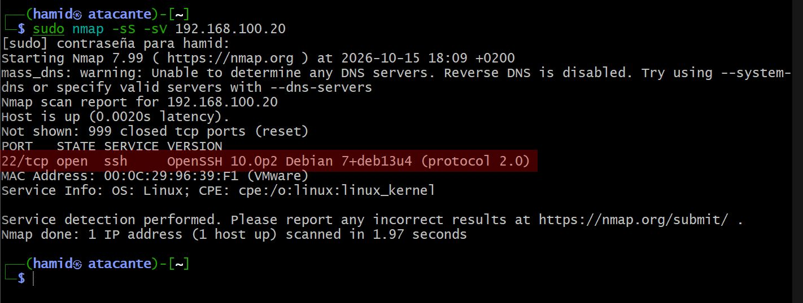
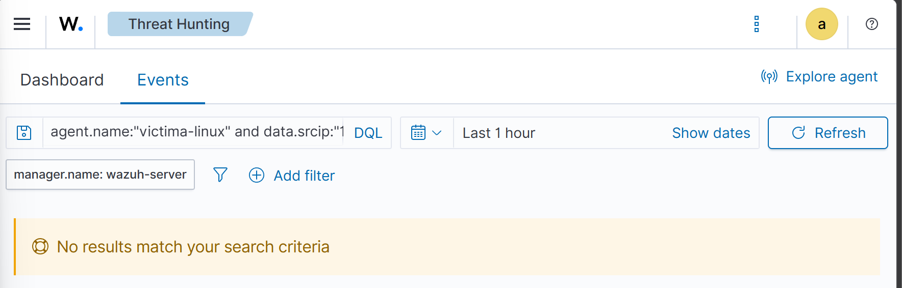
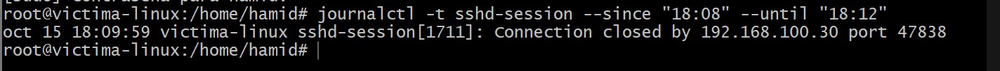

# 07 - Ataque: escaneo de puertos con nmap

## Objetivo

Lanzar un escaneo de puertos contra `victima-linux` desde `atacante`, usando `nmap`, y comprobar si Wazuh es capaz de detectarlo con su configuración actual (sin reglas ni fuentes de datos adicionales).

## Contexto: ¿qué es un escaneo de puertos?

Antes de atacar un sistema, un atacante real casi siempre hace primero un **reconocimiento**: descubre qué puertos están abiertos (qué servicios corren) para decidir por dónde entrar. En MITRE ATT&CK esto se clasifica como **T1046 — Network Service Discovery**, dentro de la táctica *Discovery*.

A diferencia de un ataque de fuerza bruta SSH (que genera logs explícitos de intentos de login), un escaneo de puertos puede ser mucho más silencioso, dependiendo de la técnica usada.

## Aislamiento del laboratorio

Se confirmó, antes de atacar, que `atacante` seguía sin salida a internet (NAT desconectada) pero con conectividad al resto del laboratorio:

```bash
ping -c 2 192.168.100.20
# funciona (red del laboratorio)

wget --timeout=5 -O /dev/null https://deb.debian.org
# falla - "Fallo temporal en la resolución del nombre" (sin internet)
```

## Ataque

```bash
sudo nmap -sS -sV 192.168.100.20
```

- `-sS`: escaneo SYN ("sigiloso" o "medio abierto") — envía el primer paquete de la conexión (SYN) y la corta antes de completarla, sin usar una conexión TCP real. Requiere privilegios de administrador.
- `-sV`: intenta detectar la versión del software que corre en cada puerto abierto.

Resultado:

```
PORT   STATE SERVICE VERSION
22/tcp open  ssh     OpenSSH 10.0p2 Debian 7+deb13u4 (protocol 2.0)
Not shown: 999 closed tcp ports (reset)
```



Solo el puerto 22 (SSH) está abierto, coherente con la instalación mínima de `victima-linux` (Fase 3).

## Detección en Wazuh

Se revisó **Threat Hunting → Events** con el filtro:

```
agent.name:"victima-linux"
```

sin encontrar ningún evento correspondiente al momento del escaneo (18:09-18:10). Se repitió la búsqueda acotando por el origen del ataque:

```
agent.name:"victima-linux" and data.srcip:"192.168.100.30"
```

Resultado: **"No results match your search criteria"**.



## Verificación en la fuente original

Para descartar que fuera un problema de indexación de Wazuh (y no de detección), se revisó el log original en `victima-linux`:

```bash
journalctl -t sshd-session --since "18:08" --until "18:12"
```

```
oct 15 18:09:59 victima-linux sshd-session[1711]: Connection closed by 192.168.100.30 port 47838
```



**Sí existe un registro del escaneo en la máquina**, generado porque `-sV` necesitó completar una conexión real al puerto 22 para leer el banner del servicio (identificar la versión de SSH). El escaneo `-sS` en sí, sin `-sV`, probablemente no habría dejado ni siquiera esta línea, al no completarse nunca la conexión TCP.

## Hallazgo clave

El log existe en el sistema, pero **no generó ninguna alerta en Wazuh** ni aparece indexado en absoluto en el panel. La razón: Wazuh solo reacciona a patrones que tiene definidos en sus reglas (usuario inválido, contraseña incorrecta, etc.). Un mensaje tan genérico como `"Connection closed by X port Y"` no coincide con ninguna regla del conjunto por defecto — no es un fallo de autenticación ni ningún patrón reconocido como sospechoso, así que pasa completamente desapercibido.

Esto expone una limitación real de la detección basada en logs de host (como la que usa Wazuh aquí): solo detecta lo que alguien ha definido explícitamente como sospechoso. Un escaneo de puertos, que opera a nivel de red antes de que haya ninguna autenticación de por medio, queda fuera de su alcance salvo que se añadan fuentes de datos adicionales (por ejemplo, logs de firewall con todas las conexiones entrantes registradas) o una herramienta complementaria de detección de red (un NIDS, como Suricata).

## Estado de la fase

- [x] Laboratorio aislado y conectividad verificada antes del ataque
- [x] Escaneo de puertos ejecutado con `nmap -sS -sV`
- [x] Comprobado que Wazuh no generó ninguna alerta ni indexó el evento
- [x] Confirmado en el log original (`journalctl`) que el evento sí ocurrió en el sistema
- [x] Hallazgo documentado: brecha de detección por diseño, no por error de configuración
- [ ] Siguiente escenario: IR-003 (modificación de ficheros críticos)
